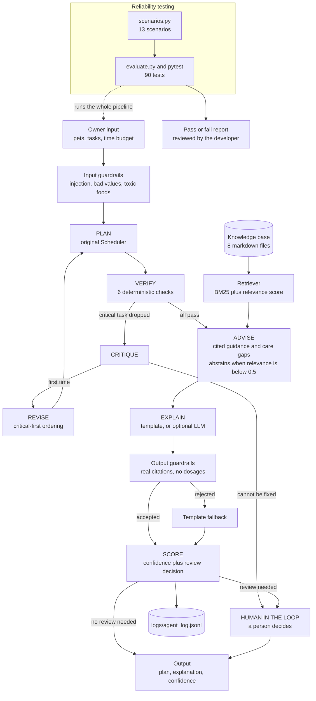

# PawPal+ AI architecture

Source of truth: [`system_diagram.mmd`](system_diagram.mmd). Rendered below by GitHub.

## Reading the diagram

- **Data flow:** owner input goes through input guardrails, the planner, and verification. Retrieval feeds the advisor, then an explanation is written and checked before it reaches the user.
- **Where a person is involved:** the HUMAN IN THE LOOP node. The agent sends a plan there when a critical task cannot be scheduled, or when a hazard or injection is flagged, or when confidence is below 0.6.
- **Where testing is involved:** the Reliability testing box runs the whole pipeline on 13 scenarios and 90 tests, and produces a report that the developer reviews.

## Where each key term lives

| Term | Where |
|------|-------|
| RAG | `pawpal_ai/knowledge_base.py`, `advisor.py`, `knowledge/*.md` |
| agent / orchestration | `pawpal_ai/agent.py` (`PlanningAgent.run`) |
| guardrail | `pawpal_ai/guardrails.py` |
| human-in-the-loop | `needs_human_review` and `review_reasons` on `AgentResult` |
| verification | `guardrails.verify_plan`, six checks after every plan |
| reliability testing | `scenarios.py`, `evaluate.py`, `tests/test_ai_*.py` |
